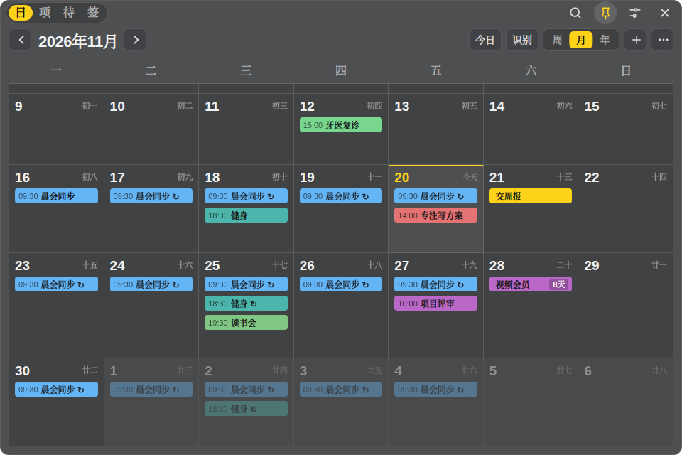

# 小叶便签

小叶便签把**日程、项目、待办和便签**放进一个轻量的 Windows 桌面窗口。

- **低内存常驻**。小窗口可以置顶，也能靠边隐藏。空闲时释放界面资源，需要时从托盘唤回。
- **多电脑同步**。用自己的 Supabase 云端备份日程、待办、项目树和便签文字，换到另一台电脑登录同一账号即可下载恢复。
- **企业微信每日定时提醒**。可自选发送时间和内容。比如每天 08:30 在企业微信群收到今天的日程和待办，也可以另设晚上提醒，提前看看明天的安排。



## 看看怎么用

**复制一段通知，一键识别导入**



**批量删除日程**



**4 步开启多电脑同步**



完整说明见 **[用户手册](docs/用户手册.md)**。

## 主要功能

- **日程**：周 / 月 / 年视图、农历与节假日、重复日程、拖动改期、批量删除、订阅到期提醒。
- **识别**：复制通知或课表文字，自动提取日期、时间和标题，已存在的日程不会重复导入。
- **待办与项目树**：普通、目标、流动三种任务，可拖进日历排期。
- **便签**：文件夹、归档、自动保存。
- **提醒**：支持 Windows 系统通知。配置企业微信群机器人后，可设置每日定时汇总，也可在事项开始前提醒。
- **多电脑同步（可选）**：用自己的 Supabase 项目上传备份，另一台电脑登录同一账号后选择下载。

## 下载使用

1. 在 [Releases](../../releases) 下载最新的压缩包，解压到当前用户可写的文件夹（例如 `D:\小叶便签`）。
2. 双击 `小叶便签-完整版.exe`。数据保存在同目录的 `user-data` 文件夹中，整个文件夹请一起保留。
3. 右下角托盘图标可以显示或退出程序。

系统要求：Windows 10 / 11（x64），需要 Microsoft Edge WebView2 Runtime。

## 从源码构建

需要：Windows 10/11 x64、[Rust](https://rustup.rs/)（MSVC 目标）、Visual Studio C++ Build Tools 与 Windows SDK、Node.js 22 win-x64 的 `node.exe`。

```powershell
# 1. 把 node.exe（Node 22 win-x64）放到 bridge\node.exe
# 2. 编译原生外壳
.\build.ps1
# 3. 运行
.\小叶便签-完整版.exe
```

| 目录 | 内容 |
| --- | --- |
| `app/src/renderer` | 界面（HTML / CSS / JS） |
| `app/src/electron` | 后台逻辑（数据、同步、提醒） |
| `app/src/shared` | 前后台共用的数据规则 |
| `app/sync` | Supabase 初始化脚本；`init.sql` 与 `init-reminders.sql` 由 `tools/build-init-sql.py` 生成 |
| `bridge` | 让后台逻辑运行在 Node 上的适配层 |
| `native` | Rust + WebView2 原生窗口外壳 |
| `docs` | 用户手册、截图和动画演示 |

修改 `app/sync` 下的分步 SQL 后，运行 `python tools/build-init-sql.py` 重新生成初始化脚本。

## 隐私

- 本地日程、便签、文字识别和系统提醒可离线使用。云端备份和企微提醒需要联网。
- 开启同步后，数据只存进**你自己的** Supabase 项目，经 HTTPS 传输并受行级安全保护；不是端到端加密。
- 云端备份包括日程、待办、项目树和便签文字。图片附件、窗口设置和订阅密码留在本机。

## 许可证

[MIT](LICENSE)。第三方组件的许可证见 `app/src/renderer/vendor/THIRD_PARTY_NOTICES.txt`。
