# 小叶便签 用户手册

一个低内存、可常驻 Windows 桌面的小窗口，把**日程、项目、待办和便签**放在一起。需要时可开启多电脑同步，也可以设置企业微信每天在指定时间发送提醒。基础功能无需注册，数据默认保存在本机。

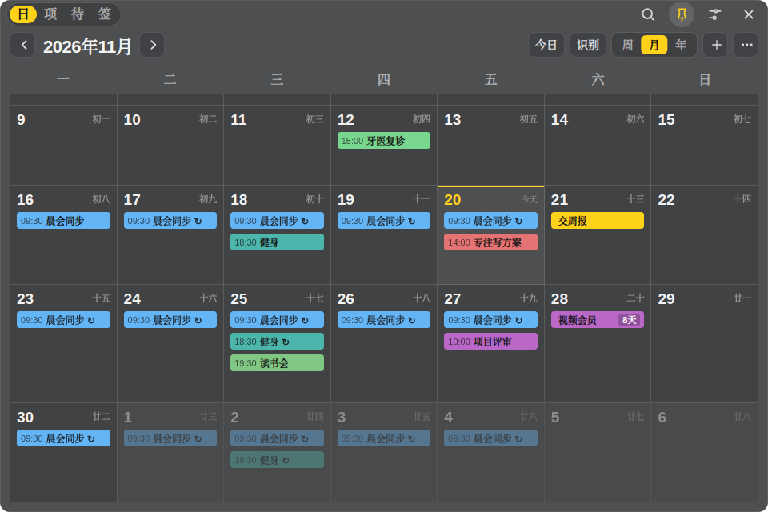

---

## 1. 认识界面

窗口左上角的 **日 · 项 · 待 · 签** 切换四个页面（快捷键 `Ctrl+1`～`Ctrl+4`）。右上角依次是：搜索、置顶、设置、关闭。

| 页面 | 用来做什么 |
| --- | --- |
| 日 | 日历：周 / 月 / 年视图，农历和节假日 |
| 项 | 项目树：把大目标拆成子任务 |
| 待 | 待办清单 |
| 签 | 便签与笔记 |

点 × 只是把窗口收起来，程序还在托盘里运行，提醒照常。要彻底退出，右键托盘图标选退出。

---

## 2. 日程

### 新建与编辑

- **双击某一天**或点右上角 **＋** 新建日程；点已有日程打开编辑框。
- 编辑框顶部可以切换 **日程 / 待办 / 课程 / 订阅** 四种类型。标题右边的下拉框选属性：**普通 / 目标 / 流动**。
- 只有选了“重复”时，才会出现“重复截至”。

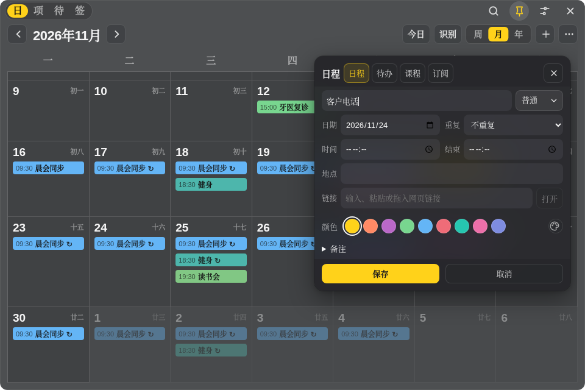

### 常用操作

- **改期**：把日程拖到另一天。
- **删除**：在编辑框点删除，或把日程拖到 **⋯ → 拖入以移除日程**。删除的内容进回收站，`Ctrl+Z` 可以撤销。
- **重复日程**：默认只改这一次；在编辑框勾选“关联”后，修改和拖动作用于整组。
- 点 **今日** 回到今天；点 **周 / 月 / 年** 切换视图。

### 订阅到期提醒

类型选 **订阅**，填写账号、订阅日期和到期日期，可以用“计算到期”按 1 个月、3 个月、1 年或天数推算。日历上显示剩余天数，过期后徽标变红。密码只加密保存在本机，点“复制”取用。

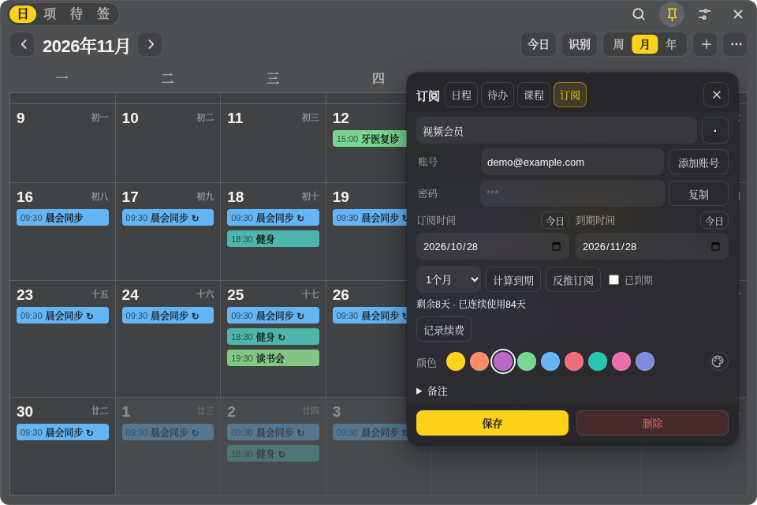

---

## 3. 识别：复制文字，一键导入

复制一段通知或安排，点日历上方的 **识别**：软件自动读取剪贴板，识别出日期、时间和标题。核对后点 **导入**。


- 已经存在的日程会缩成一行，默认不勾选，不会重复导入；不想导入的项也可以取消勾选。
- 点 **关键词** 可以挑选词语组合成更短的标题。
- 原文没有日期时，以右上角的“参考”日期为准。
- **课程** 模式：粘贴课表文字，或直接填写课程名、周次、星期和节次，一次生成整学期的课程。

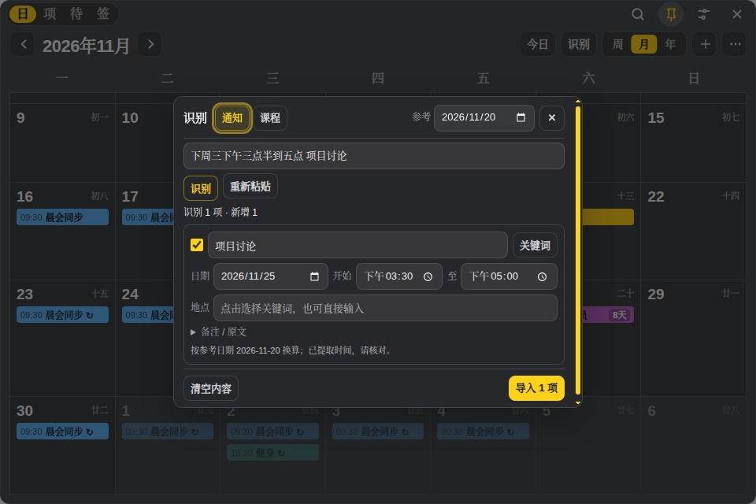

> 识别是本机规则，不联网。结果请核对后再导入，尤其是地点。

---

## 4. 更多菜单与批量删除

日历右上角 **⋯** 里是不常用的功能：流动浮窗、批量删除、连续月视图、今日浮窗、显示待办、连续拖入、节假日。

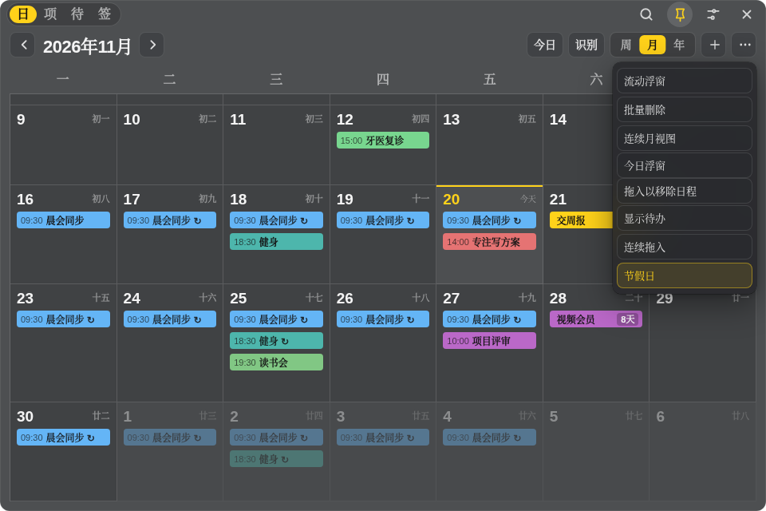

**批量删除**：打开后，点日程即可多选，点日期空白处选中当天全部，然后点 **删除**，完成后点 **完成** 退出。删除的日程可以在回收站恢复。


---

## 5. 待办、项目树、便签

| 待办 | 项目树 | 便签 |
| --- | --- | --- |
| 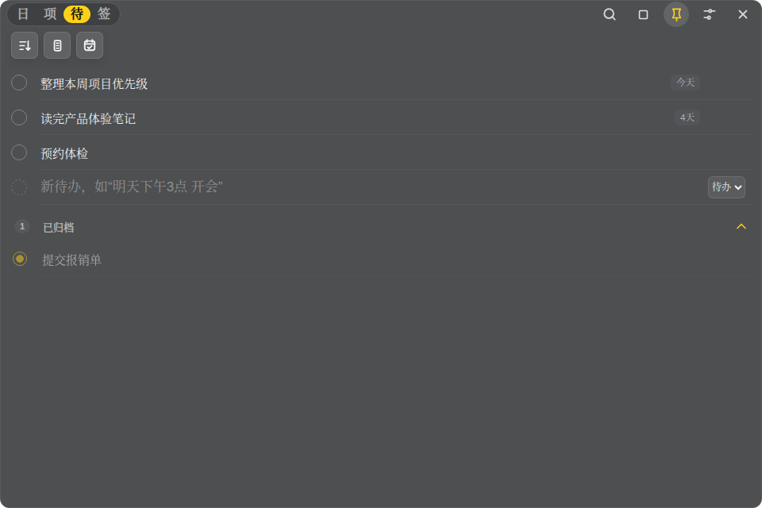 | 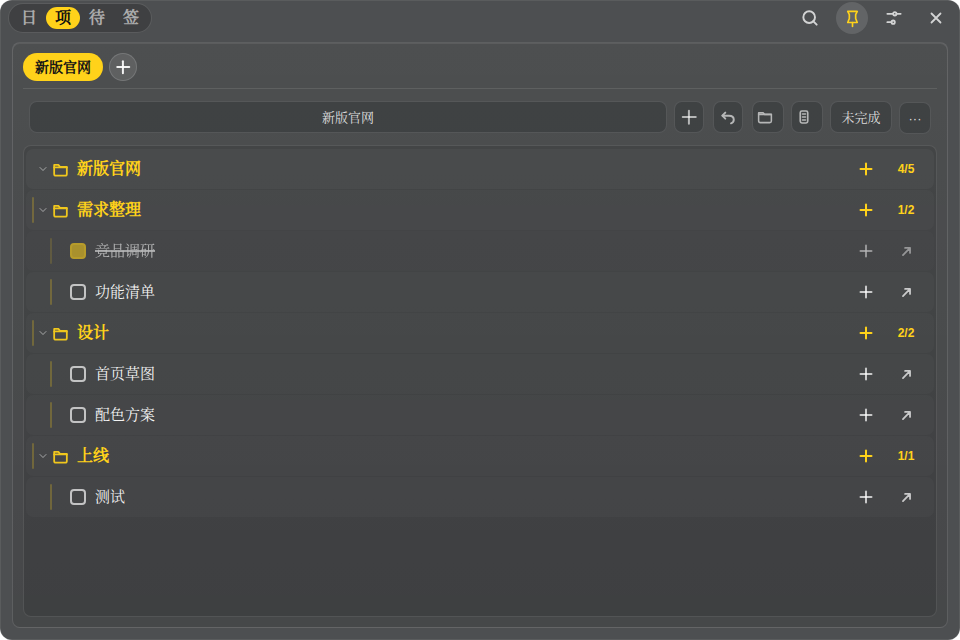 | 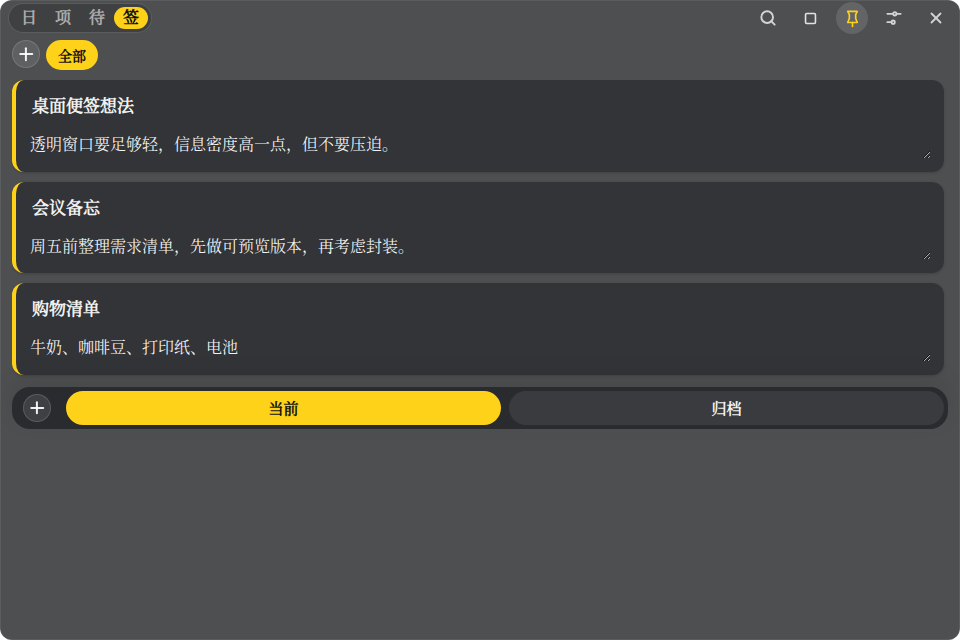 |

- **待办**：在输入框直接写“明天下午3点 开会”，会自动识别时间。把待办拖进日历就能排期。
- **目标**：属性选“目标”后挂到项目树的某个节点下，完成情况会同步显示在项目树里。
- **流动**：长期跟进的任务，显示在“流动浮窗”里，不占日历格子。
- **便签**：支持文件夹和归档，`Ctrl+N` 新建，`Ctrl+Enter` 保存。

---

## 6. 提醒

- **Windows 通知**：日程和待办到时间会弹出系统通知。
- **提醒时间**（设置 → 提醒时间）：设置早间汇总、晚间汇总的时间，以及提前几分钟提醒。
- **企业微信提醒**（可选）：按下一节完成云端和群机器人配置后，进入 **设置 → 企微提醒** 新增规则。发送方式选「每天定时」，再选时间、今天或明天，以及要提醒的日程和待办。例如设为每天 08:30 发送今日事项。也可以新增一条「事项开始前」规则。

---

## 7. 多电脑同步（可选）

需要在几台电脑上共用日程和待办时，用你自己的免费 Supabase 云端。打开 **设置 → 多电脑同步**，按窗口里的 4 步操作：


1. **注册免费云端**：点“打开注册页面”，注册 Supabase 后新建一个项目（名称随意，数据库密码自己保管）。
2. **粘贴连接信息**：在项目的 API Keys 页面分别复制 **Project URL** 和 **Publishable key**，每复制一个，回来点一次“从剪贴板粘贴”。
3. **初始化数据库**（只需一次）：点“复制初始化脚本”，再点“打开 SQL 编辑器”，粘贴后点 **Run**，回来点“检查”。
4. **注册或登录**：第一台电脑点“注册新账号”。如果收到确认邮件，点邮件里的链接（打开的网页显示错误也没关系），再回来点“登录”。

**第二台电脑**：在第一台电脑的同步窗口点“复制连接码”，发到第二台电脑，在第 2 步“从剪贴板粘贴”，然后用同一个账号登录。点“查看云端电脑”，选择已上传备份的来源电脑，预览后下载。

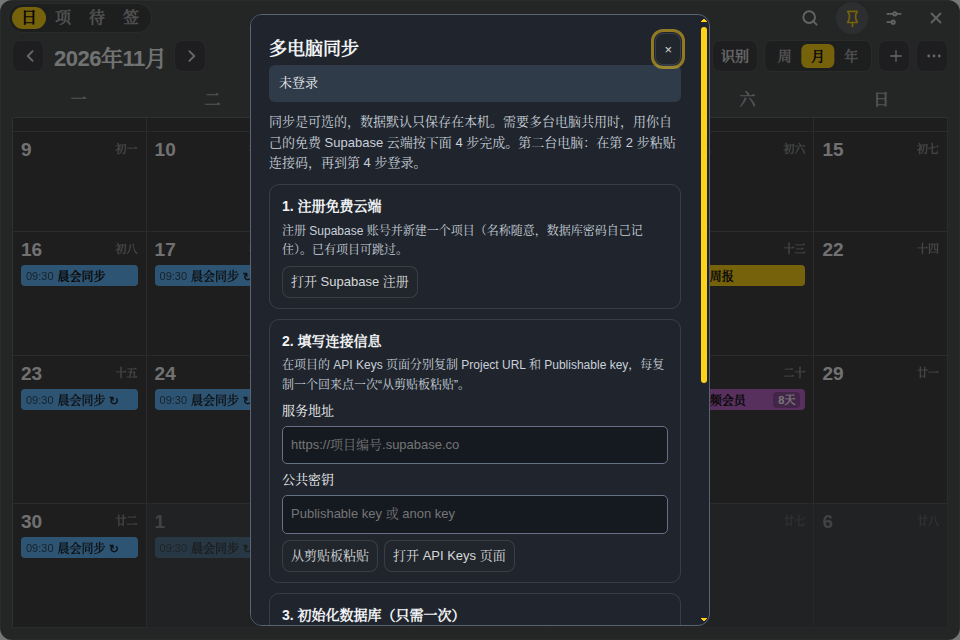

注意：

- 只填 **Publishable key**（或旧版 anon key）。不要填 Secret key 或数据库密码，软件也会拒绝它们。
- 备份包括日程、待办、项目树和便签文字。图片附件、窗口设置和订阅密码留在本机。需要在另一台电脑接收更新时，选择来源备份并下载。
- 数据经 HTTPS 传输，每个账号只能读写自己的数据，但不是端到端加密：你在 Supabase 控制台能看到自己的数据。

**企业微信提醒**：登录后点“复制企微提醒脚本”。先在 Supabase 的 Integrations 里启用 `pg_cron` 和 `pg_net`，再到 SQL 编辑器粘贴运行。之后在 **设置 → 企微提醒** 填写群机器人地址。

---

## 8. 设置与快捷键

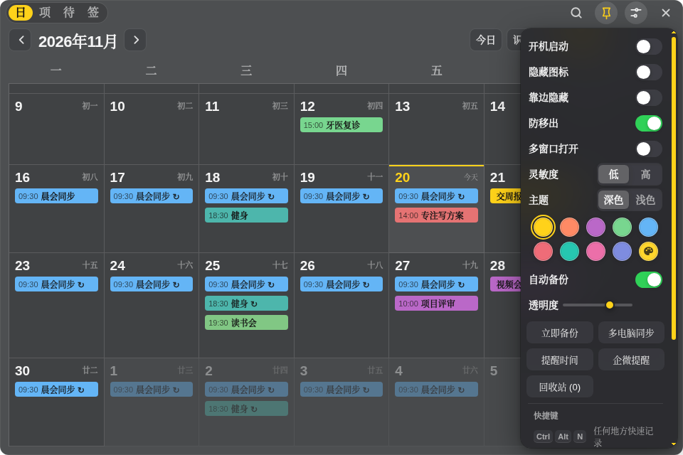

| 设置项 | 说明 |
| --- | --- |
| 开机启动 | 登录 Windows 后自动打开 |
| 隐藏图标 | 不在任务栏显示 |
| 靠边隐藏 | 把窗口拖到屏幕边缘自动收起，鼠标移过去展开 |
| 防移出 | 防止窗口跑到屏幕外 |
| 多窗口打开 | 日 / 项 / 待 / 签各开一个窗口；不开时也可以按住 `Ctrl` 点击临时新开 |
| 主题、颜色、透明度 | 深色 / 浅色，主题色，窗口透明度 |

浅色主题效果：

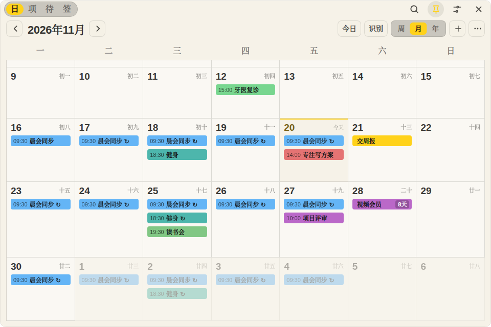

| 快捷键 | 作用 |
| --- | --- |
| `Ctrl+Alt+N` | 在任何地方快速记录 |
| `Ctrl+N` | 新建待办 / 便签 / 日程 |
| `Ctrl+1`～`Ctrl+4` | 切换 日 / 项 / 待 / 签 |
| `Ctrl+K` | 搜索，`↑` `↓` 选择，`Enter` 打开 |
| `Ctrl+Enter` | 完成待办 / 保存便签 |
| `Ctrl+Z` | 撤销删除 |

---

## 9. 数据与备份

- 所有数据保存在程序目录的 `user-data` 文件夹。搬到新电脑时，退出程序后复制整个程序文件夹即可。订阅密码和同步登录是用本机系统加密的，换电脑后需要重新填写、重新登录。
- 每天自动备份到 `user-data\backups`；也可以在设置里点“立即备份”。
- 删除的内容先进 **回收站**（设置 → 回收站），可以恢复或彻底删除。

---

## 10. 常见问题

**点了关闭，提醒还有吗？**
有。关闭只是收起窗口，程序在托盘里继续运行。

**识别结果不准怎么办？**
导入前可以直接修改每一项；标题可以用“关键词”重新组合。不需要的项取消勾选即可。

**同步时提示“数据库还没有初始化”？**
回到第 3 步，把初始化脚本粘贴到 SQL 编辑器运行一次，再点“检查”。

**注册后登录提示“邮箱或密码不正确”？**
新注册的账号需要先到邮箱点确认链接。也可以在 Supabase 的 Authentication 设置里关闭邮箱确认。

**换电脑后要重新登录吗？**
要。登录状态由每台电脑的系统单独加密保存，不能复制到别的电脑。
